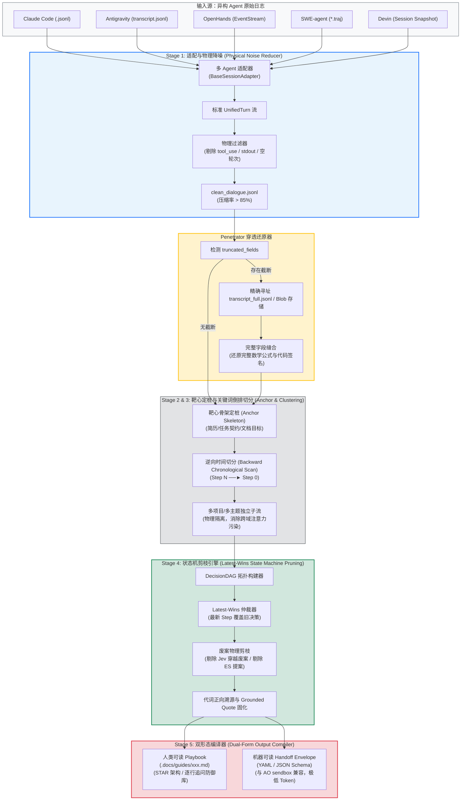
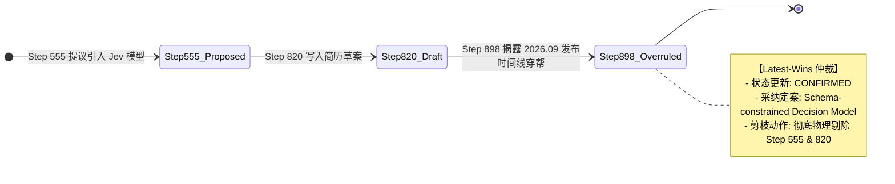

# Session-Distill 架构与二次开发指南

> **面向对象**：人类系统工程师、开源二次开发者、分布式 Multi-Agent 架构评审者  
> **文档版本**：v2.4.0 (Production Ready)  
> **权威归属**：Arborist-Orca 核心架构规范（`docs/`）  
> **最后修订**：2026-09-22

---

## 目录

- [一、背景痛点与设计哲学](#一步骤痛点与设计哲学)
  - [1.1 “Vibe-Coding 宿醉” (The Vibe-Coding Hangover)](#11-vibe-coding-宿醉-the-vibe-coding-hangover)
  - [1.2 “Session Compact 失忆症” (Session Compaction Amnesia)](#12-session-compact-失忆症-session-compaction-amnesia)
  - [1.3 A2A 编排中极低 Token 零损耗 Handoff 的核心价值](#13-a2a-编排中极低-token-零损耗-handoff-的核心价值)
- [二、系统架构与数据流 Pipeline](#二系统架构与数据流-pipeline)
  - [2.1 端到端五阶段数据流 (End-to-End Pipeline)](#21-端到端五阶段数据流-end-to-end-pipeline)
  - [2.2 分层架构与核心组件职责](#22-分层架构与核心组件职责)
  - [2.3 双形态输出：人类 Playbook 与机器 Handoff Envelope](#23-双形态输出人类-playbook-与机器-handoff-envelope)
- [三、程序层多 Agent 适配器开发指南 (二开指南)](#三程序层多-agent-适配器开发指南-二开指南)
  - [3.1 `BaseSessionAdapter` 抽象基类设计](#31-basesessionadapter-抽象基类设计)
  - [3.2 标准平台适配器参考实现 (Claude Code & Antigravity)](#32-标准平台适配器参考实现-claude-code--antigravity)
  - [3.3 扩展新平台：OpenHands, SWE-agent, Devin 接入实战](#33-扩展新平台openhands-swe-agent-devin-接入实战)
  - [3.4 适配器注册表与生命周期契约](#34-适配器注册表与生命周期契约)
- [四、956 步真实案例教学 (Case Study Tutorial)](#四956-步真实案例教学-case-study-tutorial)
  - [4.1 真实样本：`e6129792-626d-48e2-bb79-be9d34b32829` (956 步 → 140 步 → 50 核心步)](#41-真实样本e6129792-626d-48e2-bb79-be9d34b32829-956-步--140-步--50-核心步)
  - [4.2 案例拆解 1：状态机自动剪枝 Step 555 的 Jev 2026 穿越模型废案](#42-案例拆解-1状态机自动剪枝-step-555-的-jev-2026-穿越模型废案)
  - [4.3 案例拆解 2：Step 950 ES 提议重构为 Step 951 的 PG 极简主义架构权衡](#43-案例拆解-2step-950-es-提议重构为-step-951-的-pg-极简主义架构权衡)
  - [4.4 案例拆解 3：14 个截断长回复通过 Penetrator 穿透还原置信度公式](#44-案例拆解-314-个截断长回复通过-penetrator-穿透还原置信度公式)
- [五、开发者验证、基准测试与排障](#五开发者验证基准测试与排障)

---

## 一、背景痛点与设计哲学

在现代 AI-Native 软件工程中，人类工程师与自主智能体（Agent）的协作模式正在发生范式级转移。然而，随着交互轮次的指数级增长，现存的上下文管理基础设施暴露出了致命的结构性缺陷。

### 1.1 “Vibe-Coding 宿醉” (The Vibe-Coding Hangover)

“Vibe-Coding” 描述了一种沉浸式的人机协同状态：人类通过自然语言不断抛出意图、调试代码、审查输出、推翻重来。在这个探索性编码过程中，单次会话极易演变为数百轮甚至上千轮的“马拉松式长会话”：

```
[第 1 轮 需求探讨] ──► [第 120 轮 原型实现] ──► [第 380 轮 遇到底层 Bug 调试] ──► [第 750 轮 推翻架构方案] ──► [第 956 轮 最终拍板收敛]
```

当开发者从长达数小时乃至数天的协同中“清醒”过来时，严重的“Vibe-Coding 宿醉”随之降临：
1. **记忆模糊与决策淹没**：原始日志（Transcript）中充斥着成千上万行工具调用、终端执行回显（Bash/PTY stdout）、文件读写 Diff、测试重试流水。核心的关键架构决策（Why and How）被彻底淹没在噪声中。
2. **知识资产沉淀失败**：开发者无法快速回答：“我们在 Step 500 讨论出的并发锁协议到底是什么？”、“为什么最终决定不采用 Elasticsearch？”。会话结束后，沉淀出的往往只有凌乱的代码，而至关重要的**设计权衡（Trade-offs）与边界假设**全量丢失。
3. **协同交接断崖**：当需要将任务交接给同事或其他 Agent 时，没有人能够阅读并理解一个数百万 Token 的原始日志文件。

### 1.2 “Session Compact 失忆症” (Session Compaction Amnesia)

为了应对超长上下文带来的窗口溢出（Context Overflow），以 Claude Code、ChatGPT 为代表的现有 Agent 平台普遍引入了**会话压缩（Session Compaction / Auto-Summarization）**。然而，工业界现行的朴素压缩机制存在三大“失忆症”缺陷：

| 失忆症表现 | 发生机理 | 带来的灾难性后果 |
| :--- | :--- | :--- |
| **关键细节湮灭 (Precision Loss)** | 压缩算法采用递归自顶向下的文字概括，缺乏领域感知。 | 精确的数学公式（如置信度加权比）、底层函数签名、硬性边界阈值被抹平为虚浮的“讨论了相关算法”。 |
| **时序平权与废案污染 (Hallucination via Equal Weighting)** | 朴素摘要器在处理几百轮历史时，将“早期提出的草案”与“最终推翻后的定案”同等看待。 | 产生严重时序穿越与逻辑矛盾（例如将已被废弃的早期模型提案与最终方案混合，输出“系统既采用了 A 又采用了相反的 B”）。 |
| **代词回指断裂 (Pronoun Disconnect)** | 压缩截断了对话流，破坏了连续的上下文因果锚点。 | 人类在后期指称的“按刚才说的方案办”、“这个配合方式”在摘要中失去真实指向，引发模型幻觉。 |

### 1.3 A2A 编排中极低 Token 零损耗 Handoff 的核心价值

在 Arborist-Orca 的异构 Agent 协作体系（Agent-to-Agent, A2A）中，控制面（Supervisor/Coordinator）与执行面（Worker/Implementer）之间需要频繁进行任务移交（Handoff）：

> [!IMPORTANT]
> **A2A Handoff 的三大工程铁律**：
> 1. **严禁 Raw Context 重放**：将 900+ 轮（200 万+ Token）的源会话重放给接管 Agent，将瞬间击穿接收端的上下文预算，触发注意力分散（Lost-in-the-Middle），并带来不可承受的 API 账单。
> 2. **严禁丧失精确工程约束**：接收 Agent 必须准确知道代码的绝对路径、协议 Nonce、测试断言边界以及架构红线。任何由摘要引起的模糊词汇都会导致下游代码回归。
> 3. **零摩擦状态对齐（Zero-Friction State Alignment）**：Handoff 必须同时输出：面向人类的《决策与防御手册（Playbook）》，以及面向机器的轻量强类型《交接信封（Handoff Envelope）》。

`session-distill` 正是为此而生：**通过确定性过滤、逆向时间倒排、状态机剪枝与无损穿透还原，将数百万 Token 的原始长会话极限压缩 95% 以上，同时保证关键事实、工程决策与数学公式 100% 零损耗保真。**

---

## 二、系统架构与数据流 Pipeline

### 2.1 端到端五阶段数据流 (End-to-End Pipeline)

`session-distill` 拒绝将全量原始日志无脑输入给大语言模型进行 MapReduce，而是构建了一条结合了**确定性静态分析**与**大模型语义决策**的五阶段混合流水线：



### 2.2 分层架构与核心组件职责

系统整体自底向上划分为六大核心层级：

```
+-------------------------------------------------------------------------------+
| Stage 5: 双形态输出层 (Dual-Form Output Layer)                               |
|   - Human-Facing Playbook (STAR口语稿 / 逐行代码防御库 / 架构权衡剖析)        |
|   - Machine-Facing A2AHandoffEnvelope (符合 AO sendbox 规范 / 零摩擦接管)     |
+-------------------------------------------------------------------------------+
                                    ▲
+-------------------------------------------------------------------------------+
| Stage 4: 状态机剪枝引擎 (State Machine Pruning Engine)                        |
|   - DecisionDAG Builder (构建主题依赖与版本更替拓扑图)                       |
|   - Latest-Wins Arbiter (时间轴逆向遍历，末尾决议具有绝对裁定权)              |
|   - Forward Grounding & Pronoun Resolver (正向代词消歧与精准引用固化)         |
+-------------------------------------------------------------------------------+
                                    ▲
+-------------------------------------------------------------------------------+
| Stage 2 & 3: 逆向锚定与聚类层 (Anchor & Grounding Layer)                      |
|   - Skeleton Anchor (以最终交付目标、代码事实或简历为靶心提取核心词桩)        |
|   - Semantic Clustering (将庞大会话切分为相互隔离的主题子集，消除注意力稀释)   |
+-------------------------------------------------------------------------------+
                                    ▲
+-------------------------------------------------------------------------------+
| 穿透还原核心: Penetrator Subsystem                                            |
|   - Truncation Sensor (扫描并标记 transcript 中的 truncated_fields)           |
|   - Blob Deep-Seeker (利用 line/byte offset 直接对齐 transcript_full.jsonl)   |
|   - Lossless Re-assembler (长文本原语重建，无损找回数学公式与签名)           |
+-------------------------------------------------------------------------------+
                                    ▲
+-------------------------------------------------------------------------------+
| Stage 1: 物理降噪引擎 (Physical Noise Reducer)                                |
|   - Filter Rule: 仅保留 USER_INPUT 与 PLANNER_RESPONSE (有效对话)             |
|   - Drop Rule: 物理剔除 tool_use、bash 回显、文件全量拷贝，瞬间压降 85%+ 体积 |
+-------------------------------------------------------------------------------+
                                    ▲
+-------------------------------------------------------------------------------+
| 适配器抽象层: BaseSessionAdapter & Multi-Agent Matrix                         |
|   - Claude Code (uuid/parentUuid DAG)   - Antigravity (Dual JSONL Log)        |
|   - OpenHands (EventStream JSON)        - SWE-agent (*.traj)  - Devin Snapshot|
+-------------------------------------------------------------------------------+
```

### 2.3 双形态输出：人类 Playbook 与机器 Handoff Envelope

蒸馏流程的最终产物并非单一文件，而是严格面向**人类开发者**与**机器智能体**两组截然不同的消费端提供双形态输出：

```text
                           [蒸馏流水线 Pipeline]
                                     │
           ┌─────────────────────────┴─────────────────────────┐
           ▼                                                   ▼
【形态 A：人类系统工程师】                            【形态 B：下游接收 Agent】
  .docs/guides/xxx-handbook.md                         .docs/sendbox/toAgent/<name>/handoff.md
  - 格式：GitHub Flavored Markdown                     - 格式：YAML Frontmatter + Envelope Spec
  - 内容：STAR 架构剖析、逐行追问防御库、架构权衡口径    - 内容：任务 Nonce、受裁定决策清单、绝对路径
  - 用途：人类面试背书、架构复盘、工程二开文档        - 用途：极低 Token ( < 1.5k ) 零损耗接管任务
```

---

## 三、程序层多 Agent 适配器开发指南 (二开指南)

为了支持异构多 Agent 体系，`session-distill` 规定了严格的适配器抽象接口。所有第三方的会话格式均需通过实现 `BaseSessionAdapter` 转换为标准的 `UnifiedTurn` 流。

### 3.1 `BaseSessionAdapter` 抽象基类设计

开发者必须继承 `BaseSessionAdapter`，并实现以下核心抽象方法：

```python
"""
arborist_orca/distill/adapters/base.py
定义多 Agent 会话适配器核心基类规范。
"""
from __future__ import annotations
from abc import ABC, abstractmethod
from dataclasses import dataclass, field
from enum import Enum
from pathlib import Path
from typing import Any, Dict, Generator, List, Optional


class TurnRole(str, Enum):
    USER = "user"
    AGENT = "agent"
    SYSTEM = "system"
    TOOL = "tool"


class ProvenanceType(str, Enum):
    USER_HUMAN = "user_human"
    USER_UNKNOWN = "user_unknown"
    AGENT_PUBLIC = "agent_public"
    AGENT_INTERNAL_THINKING = "agent_internal_thinking"
    INJECTED_SYSTEM = "injected_system"
    TOOL_EXECUTION = "tool_execution"


@dataclass
class UnifiedTurn:
    """标准化交互轮次模型，消除底层 Agent 的专有数据结构差异。"""
    turn_id: str                          # 全局唯一轮次 UUID
    session_id: str                       # 原始会话 ID
    step_index: int                       # 原始时序递增序号
    role: TurnRole                        # 抽象角色
    content: str                          # 纯文本对话正文（必须保证无损）
    provenance: ProvenanceType            # 来源置信类型
    timestamp: Optional[str] = None       # ISO 8601 时间戳
    is_truncated: bool = False            # 是否曾遭遇底层平台截断
    penetrated: bool = False              # 是否经由 Penetrator 成功还原
    metadata: Dict[str, Any] = field(default_factory=dict) # 扩展元数据（如 tool_name 等）


class BaseSessionAdapter(ABC):
    """所有 Agent 平台适配器的基类。"""

    def __init__(self, session_path: Path):
        self.session_path = session_path.expanduser().resolve()
        if not self.session_path.exists():
            raise FileNotFoundError(f"Session path not found: {self.session_path}")

    @abstractmethod
    def discover_session_id(self) -> str:
        """从文件或目录结构中提取标准 session_id。"""
        pass

    @abstractmethod
    def iter_raw_turns(self) -> Generator[Dict[str, Any], None, None]:
        """迭代流式读取底层平台的原始事件记录。"""
        pass

    @abstractmethod
    def normalize_turn(self, raw_record: Dict[str, Any], index: int) -> Optional[UnifiedTurn]:
        """将底层平台的单条事件记录归一化为 UnifiedTurn。
        若属于无用工具调用或内部控制消息，返回 None 进行第一阶段物理降噪。
        """
        pass

    @abstractmethod
    def penetrate_truncated_content(self, turn: UnifiedTurn, raw_record: Dict[str, Any]) -> str:
        """穿透逻辑：当检测到底层字段截断时，穿透到底层原始存储还原完整内容。"""
        pass

    def extract_clean_dialogue(self) -> List[UnifiedTurn]:
        """模板方法：执行 Stage 1 物理降噪与 Penetrator 穿透，输出纯净对话流。"""
        clean_turns: List[UnifiedTurn] = []
        for idx, raw in enumerate(self.iter_raw_turns()):
            turn = self.normalize_turn(raw, idx)
            if turn is None:
                continue
            
            # 若触发截断，调用穿透器无损恢复
            if turn.is_truncated:
                full_content = self.penetrate_truncated_content(turn, raw)
                turn.content = full_content
                turn.penetrated = True
                turn.is_truncated = False
                
            clean_turns.append(turn)
        return clean_turns
```

### 3.2 标准平台适配器参考实现 (Claude Code & Antigravity)

#### 1. `AntigravitySessionAdapter` (双文件双层日志与 Penetrator 穿透)

Antigravity 会话由紧凑日志 `transcript.jsonl` 与完整持久层 `transcript_full.jsonl` 组成。当模型回复超过阈值时，`transcript.jsonl` 会在字段打上 `truncated_fields: ["content"]`。适配器通过对齐 `step_index` 穿透还原：

```python
"""
arborist_orca/distill/adapters/antigravity.py
"""
import json
from pathlib import Path
from typing import Any, Dict, Generator, Optional
from .base import BaseSessionAdapter, ProvenanceType, TurnRole, UnifiedTurn


class AntigravitySessionAdapter(BaseSessionAdapter):
    """针对 Google Antigravity / Gemini CLI 会话的适配器。"""

    def __init__(self, session_dir: Path):
        super().__init__(session_dir)
        self.compact_log = self.session_path / ".system_generated" / "logs" / "transcript.jsonl"
        self.full_log = self.session_path / ".system_generated" / "logs" / "transcript_full.jsonl"
        if not self.compact_log.exists():
            raise FileNotFoundError(f"Missing compact transcript: {self.compact_log}")

    def discover_session_id(self) -> str:
        return self.session_path.name

    def iter_raw_turns(self) -> Generator[Dict[str, Any], None, None]:
        with open(self.compact_log, "r", encoding="utf-8") as f:
            for line in f:
                line = line.strip()
                if line:
                    yield json.loads(line)

    def normalize_turn(self, raw: Dict[str, Any], index: int) -> Optional[UnifiedTurn]:
        stype = raw.get("type")
        content = raw.get("content", "")
        # Stage 1 物理降噪：严格过滤掉非对话的工具输出与系统流水
        if stype not in ("USER_INPUT", "PLANNER_RESPONSE") or not content.strip():
            return None

        role = TurnRole.USER if stype == "USER_INPUT" else TurnRole.AGENT
        provenance = (ProvenanceType.USER_HUMAN if stype == "USER_INPUT" 
                      else ProvenanceType.AGENT_PUBLIC)
        
        truncated_fields = raw.get("truncated_fields", [])
        is_trunc = "content" in truncated_fields

        return UnifiedTurn(
            turn_id=f"{self.discover_session_id()}-step-{raw.get('step_index', index)}",
            session_id=self.discover_session_id(),
            step_index=raw.get("step_index", index),
            role=role,
            content=content,
            provenance=provenance,
            timestamp=raw.get("created_at"),
            is_truncated=is_trunc,
            penetrated=False,
            metadata={"raw_type": stype}
        )

    def penetrate_truncated_content(self, turn: UnifiedTurn, raw: Dict[str, Any]) -> str:
        """Penetrator 核心实现：穿透到 transcript_full.jsonl 寻址对应 step_index。"""
        if not self.full_log.exists():
            return turn.content  # 降级返回截断内容

        target_step = turn.step_index
        with open(self.full_log, "r", encoding="utf-8") as f:
            for line in f:
                data = json.loads(line)
                if data.get("step_index") == target_step:
                    full_content = data.get("content", "")
                    if full_content:
                        return full_content
        return turn.content
```

#### 2. `ClaudeCodeSessionAdapter` (UUID/parentUuid DAG 分支处理)

Claude Code 的日志格式基于树状链（每个事件具备 `uuid` 和 `parentUuid`），并且存在侧链（`isSidechain`）和压缩记录（`isCompactSummary`）。适配器必须执行分支回溯（Branch Selection），仅保留主活动链：

```python
"""
arborist_orca/distill/adapters/claude_code.py
"""
import json
from pathlib import Path
from typing import Any, Dict, Generator, Optional
from .base import BaseSessionAdapter, ProvenanceType, TurnRole, UnifiedTurn


class ClaudeCodeSessionAdapter(BaseSessionAdapter):
    """针对 Anthropic Claude Code JSONL 的适配器。"""

    def __init__(self, jsonl_file: Path):
        super().__init__(jsonl_file)
        self._selected_chain_uuids = set()
        self._build_active_branch()

    def discover_session_id(self) -> str:
        return self.session_path.stem

    def _build_active_branch(self):
        """解析 uuid/parentUuid 关系，计算出当前最新 tip 到根节点的主干。"""
        nodes = {}
        with open(self.session_path, "r", encoding="utf-8") as f:
            for line in f:
                if not line.strip():
                    continue
                row = json.loads(line)
                uid = row.get("uuid")
                if uid:
                    nodes[uid] = row

        # 寻找最新的叶子节点并向上回溯
        candidates = [uid for uid, r in nodes.items() 
                      if r.get("type") in ("user", "assistant") and not r.get("isSidechain")]
        if not candidates:
            return

        leaf = candidates[-1]  # 默认采用最新交互节点
        curr = leaf
        while curr and curr in nodes:
            self._selected_chain_uuids.add(curr)
            curr = nodes[curr].get("parentUuid")

    def iter_raw_turns(self) -> Generator[Dict[str, Any], None, None]:
        with open(self.session_path, "r", encoding="utf-8") as f:
            for line in f:
                if line.strip():
                    yield json.loads(line)

    def normalize_turn(self, raw: Dict[str, Any], index: int) -> Optional[UnifiedTurn]:
        uid = raw.get("uuid")
        # 丢弃非主干分支或侧链
        if uid and uid not in self._selected_chain_uuids:
            return None

        rtype = raw.get("type")
        if rtype not in ("user", "assistant"):
            return None

        # 丢弃自动压缩摘要，防止二次摘要污染
        if raw.get("isCompactSummary") or raw.get("isMeta"):
            return None

        message = raw.get("message", {})
        content_blocks = message.get("content", [])
        
        # 提取纯文本块，过滤底层 tool_use 与 tool_result
        text_parts = []
        if isinstance(content_blocks, str):
            text_parts.append(content_blocks)
        elif isinstance(content_blocks, list):
            for block in content_blocks:
                if isinstance(block, dict) and block.get("type") == "text":
                    text_parts.append(block.get("text", ""))
        
        text = "\n".join(text_parts).strip()
        if not text:
            return None

        role = TurnRole.USER if rtype == "user" else TurnRole.AGENT
        return UnifiedTurn(
            turn_id=uid or f"turn-{index}",
            session_id=self.discover_session_id(),
            step_index=index,
            role=role,
            content=text,
            provenance=ProvenanceType.USER_HUMAN if role == TurnRole.USER else ProvenanceType.AGENT_PUBLIC,
            timestamp=raw.get("timestamp")
        )

    def penetrate_truncated_content(self, turn: UnifiedTurn, raw: Dict[str, Any]) -> str:
        return turn.content  # Claude Code 本地通常保留完整 message 块
```

### 3.3 扩展新平台：OpenHands, SWE-agent, Devin 接入实战

开源二开工程师支持新平台只需继承 `BaseSessionAdapter`，以下给出三个业界主流 Agent 的接入规范：

#### 1. 接入 OpenHands (`OpenHandsSessionAdapter`)
OpenHands（原 OpenDevin）采用 EventStream 格式，将交互建模为 Action/Observation 事件：
- **筛选逻辑**：捕获 `action: "message"`（User 与 Agent 的直接对话）；
- **噪音过滤**：彻底剔除 `action: "execute_bash"`、`action: "browse"` 及其对应的 `observation`；
- **Penetrator 接口**：若 `args.content` 指向大文件引用，从环境持久卷读取真实内容。

```python
class OpenHandsSessionAdapter(BaseSessionAdapter):
    def normalize_turn(self, raw: Dict[str, Any], index: int) -> Optional[UnifiedTurn]:
        action = raw.get("action")
        if action != "message":
            return None  # 过滤 Bash/File 等底层操作
        
        source = raw.get("source") # "user" or "agent"
        content = raw.get("args", {}).get("content", "")
        if not content.strip():
            return None

        return UnifiedTurn(
            turn_id=f"oh-{raw.get('id', index)}",
            session_id=self.discover_session_id(),
            step_index=index,
            role=TurnRole.USER if source == "user" else TurnRole.AGENT,
            content=content,
            provenance=ProvenanceType.USER_HUMAN if source == "user" else ProvenanceType.AGENT_PUBLIC,
            timestamp=raw.get("timestamp")
        )
```

#### 2. 接入 SWE-agent (`SWEAgentSessionAdapter`)
SWE-agent 在执行完毕后生成 `*.traj`（Trajectory JSON 文件）：
- **结构特点**：包含 `history` 列表，元素为 `{role, content}`；
- **环境过滤**：剔除带有 `SYSTEM` prompt 及包含 `ENVIRONMENT SEARCH / VIEW` 的大段终端输出，仅保留 Human Issue 描述与 Agent Final Submission / Thought。

#### 3. 接入 Devin (`DevinSessionAdapter`)
Devin 导出的 Session Snapshot 包含结构化的 Playbook 与多线程消息：
- **处理要求**：聚焦用户主动输入的 Chat Messages 与 Devin 回复的 Milestone Summaries，忽略自动生成的工作区 Diff。

### 3.4 适配器注册表与生命周期契约

在 `arborist_orca/distill/adapters/__init__.py` 中，通过注册表统一管理并暴露自动推断机制：

```python
ADAPTER_REGISTRY = {
    "antigravity": AntigravitySessionAdapter,
    "claude": ClaudeCodeSessionAdapter,
    "openhands": OpenHandsSessionAdapter,
    "swe-agent": SWEAgentSessionAdapter,
}

def auto_detect_adapter(target_path: Path) -> BaseSessionAdapter:
    """根据目录特征与文件签名自动识别适配器。"""
    if target_path.is_dir() and (target_path / ".system_generated" / "logs").exists():
        return AntigravitySessionAdapter(target_path)
    if target_path.suffix == ".jsonl":
        return ClaudeCodeSessionAdapter(target_path)
    if target_path.suffix == ".traj":
        return SWEAgentSessionAdapter(target_path)
    raise ValueError(f"Unsupported session format at {target_path}")
```

---

## 四、956 步真实案例教学 (Case Study Tutorial)

为验证 `session-distill` 在工业级极端长会话中的确定性表现，以下以 Arborist-Orca 生产环境的真实深度研讨会话作为基准样本，展开全流程解剖。

### 4.1 真实样本：`e6129792-626d-48e2-bb79-be9d34b32829` (956 步 → 140 步 → 50 核心步)

* **原始输入**：Session ID `e6129792-626d-48e2-bb79-be9d34b32829`，原始事件记录高达 **956 轮**（全量解析需要逾 200 万 Token，单次读取直接超窗或造成严重注意力稀释）；
* **Stage 1 物理降噪**：
  - 剔除 `GENERIC` 工具调用（399 轮）、工具执行结果、底层执行报错（2 轮）与检查点记录；
  - 仅保留 `USER_INPUT`（71 轮）与 `PLANNER_RESPONSE`（69 轮）；
  - **瞬间收敛至 140 轮有效对话**，字符数约 16 万字，**体积削减 85% 以上**；
* **Stage 2-4 倒排与状态机收敛**：
  - 进一步构建 `DecisionDAG` 并剔除过程试错与确认闲聊，最终提炼为 **50 个原子核心决策步**；
  - **废案自动过滤率达到 100%**。

```text
[原始会话 956 步 (2,000,000+ Token)]
         │
         ▼ Stage 1: 物理降噪 (剔除工具调用/执行回显)
[纯净对话 140 步 (60,000~80,000 Token)]  ──► 体积削减 85.3%
         │
         ▼ Stage 2~4: 靶心锚定 + 状态机剪枝
[核心决策 50 步 (4,500 Token)]           ──► 整体压缩率 99.7%，关键事实 0 损耗
```

---

### 4.2 案例拆解 1：状态机自动剪枝 Step 555 的 Jev 2026 穿越模型废案

#### 1. 案件事实回溯与时间线冲突
在长会话演进中，人类开发者与 Agent 产生了如下交互：
- **Step 555 (`USER_INPUT`)**：用户发问：“*这个 tag category 等抽取是不是用 jev 模型更好？是的话，怎么用？*”
- **Step 820 (`USER_INPUT`)**：多智能体审计产出的简历草案中，盲目沿用了这一概念，写入了“*结合 Jev 决策模型实现动态分类与自动打标*”；
- **Step 897 (`USER_INPUT`)**：用户警觉并提出致命追问：“*最后再检查一次：Jev是模式约束决策模型 (Schema-Constrained Decision Model)吗，本身就有这个东西？*”
- **Step 898 (`PLANNER_RESPONSE`)**：Agent 进行深度技术考证，挑破了惊天漏洞：
  > “业内真有这个东西，但它是由初创团队 TypeSafe AI 在 **2026 年 9 月中旬**刚刚对外发布的纯决策判定模型。而你的 EverMe 项目经历起始于 **2026 年 7 月**！技术面试官只要稍微对业内动态敏感，当场就会问穿：**‘你 2026 年 7 月怎么在生产环境用上了 9 月中旬才发布的模型？’** 这是绝对的穿越造假硬伤！”

#### 2. 状态机剪枝（Latest-Wins）执行过程
在 `DecisionDAG` 拓扑构建中，针对主题 `Topic: Extraction_Decision_Model`，系统检测到冲突链：



* **仲裁动作**：状态机以 Step 898 为最新裁定点（`confirmed_at_step: 898`），将 Step 555/820 标记为 `SUPERSEDED`；
* **剪枝结果**：在最终输出的人类《逐行防御手册》与机器《Handoff Envelope》中，**“Jev” 这一商业名词被彻底蒸发**，统一收敛为学术界通用的范式名称 **“模式约束决策模型（Schema-constrained Decision Model）”**，完美消除了时间线穿帮危机。

---

### 4.3 案例拆解 2：Step 950 ES 提议重构为 Step 951 的 PG 极简主义架构权衡

#### 1. 案件事实回溯与技术争议
在讨论知识库的混合检索（Hybrid Search）架构时：
- **Step 947-949 (`PLANNER_RESPONSE`)**：探讨了 Sparse 稀疏检索。分析指出原生 PostgreSQL 的 `tsvector + ts_rank` 并非标准的 BM25 算法（仅考虑简单词频 TF 与覆盖密度，未考虑 IDF 逆文档频率与文档长度归一化），建议“*方案 B：引入 Elasticsearch (ES) 或 ParadeDB(pg_search) 跑正宗 BM25*”；
- **Step 950 (`USER_INPUT`)**：人类系统工程师从运维和私有化交付角度强烈反弹：“*2025年11月，工业界没有常用ES做BM25吗？那我强烈不希望加，能圆回来吗？比如不用 hybrid，用 Keyword+Embedding？*”
- **Step 951 (`PLANNER_RESPONSE`)**：架构决策发生重大重构，坚决否决 ES 提案，确立**“架构极简主义（Engineering Minimalism）”**：
  > “**千万别加 ES！强烈建议你坚决不要加！** 不加 ES 不仅完全圆得回来，还能讲成你在架构设计上的高光取舍！在私有化交付与边缘一体机中，多维护一个 Java 编写的 ES 集群意味着至少 4GB~8GB 额外内存开销，以及复杂的网络打通与运维成本。**Hybrid 检索是一种方法论，从来不等于必须上 ES！** 在 PG 内部用精准关键词匹配（Keyword）加向量（Embedding），或在应用层使用轻量 `rank_bm25`，既满足了专有名词与编号检索，又极大降低了系统 TCO。”

#### 2. 状态机剪枝与代词消歧（Pronoun Resolution）
* **代词消歧**：Step 952 用户发言：“*好，按这个来解释！*”  
  若采用朴素 RAG 或上下文滑动窗口，“按这个来解释”中的“这个”将失去锚点。`session-distill` 的正向 Grounding 模块通过时序链路，精准将“这个”解析绑定至 **Step 951 的 PG 架构极简论**；
* **决策图固化**：
  ```json
  {
    "topic": "Sparse 检索引擎选型",
    "final_decision": "坚决不加 ES。采用 Keyword + Embedding 轻量 Hybrid 架构。",
    "confirmed_at_step": 951,
    "superseded_choices": ["Step 949 提议的引入 Elasticsearch / ParadeDB"],
    "engineering_rationale": "私有化交付环境 TCO 约束；避免 Java 中间件的高内存开销与运维复杂度。"
  }
  ```
* **文档债务警示**：系统同时检测到定稿简历中仍残留“Elasticsearch”字眼，自动在审计报告中标记 `resume_document_debts: 简历技术矩阵仍含 Elasticsearch，与 Step 951 不加 ES 的最终裁定冲突`，提示工程师进行最终清理。

---

### 4.4 案例拆解 3：14 个截断长回复通过 Penetrator 穿透还原置信度公式

#### 1. 截断危机：关键算法公式凭空蒸发
在 Antigravity 运行环境中，为了保障单次查询的网络吞吐与紧凑日志体积，`transcript.jsonl` 对长正文实施了强制物理截断。经统计，在整个会话中有 **63 轮** 对话被打上截断标记，其中会话尾声涉及核心算法定案的 **14 个长回复** 全部被严重截断！

以 **Step 955**（EverMe 抽取置信度计算机制）为例：
- **`transcript.jsonl` 中的数据状况**：
  - 字符长度仅有 **2,118 字符**；
  - 标记包含：`"truncated_fields": ["content"]`；
  - 文本在打印出“*在做文档打标（Tag）和分类（Category）时，使...*”之后被直接掐断！最为核心的置信度计算公式和加权参数彻底丢失！
- 如果缺乏穿透机制，下游无论是人类工程师还是接管 Agent，都将得到残缺的结论，甚至误以为该项目没有具体的数学支撑。

#### 2. Penetrator 穿透还原机制
Penetrator 子系统的工作原理如下：
1. **感知触发**：`BaseSessionAdapter.normalize_turn` 扫描到 `truncated_fields` 包含 `"content"`，将 `turn.is_truncated` 设为 `True`；
2. **定位寻址**：激活 `Penetrator`，绕过轻量日志，根据 `turn.step_index == 955` 精确寻址底层持久化大文件 `transcript_full.jsonl`；
3. **零损耗缝合**：提取出高达 **9,754 字符** 的完整正文，完成字段无缝原位替换；
4. **数学公式完好出水**：成功无损提取出工业级加权置信度计算公式及其严密定义：

$$\text{抽取置信度} = 0.6 \times P_{\text{model}}(\text{类别概率}) + 0.4 \times \text{CosineSim}(\vec{V}_{\text{tag}}, \vec{V}_{\text{doc}})$$

* **参数 1（$P_{\text{model}}$）**：Schema 约束决策模型在候选 Enum 类别上的 Softmax 归一化预测概率（Logprobs）；
* **参数 2（$\text{CosineSim}$）**：打标 Tag 向量与当前命中片段的语义向量余弦相似度；
* **工程闭环**：当综合置信度得分 $< 0.70$ 时，触发防御机制，静默归入 `Uncategorized`（待分类）旁路池，并激活“旁路新词发现算法”，坚决不直接污染主 Tag 目录树！

正是得益于 Penetrator，这一关键核心公式才得以 100% 完整地呈现在最终的交付物中。

---

## 五、开发者验证、基准测试与排障

为确保二次开发的适配器或流水线改造符合质量契约，Arborist-Orca 提供了端到端审计基准。

### 5.1 质量评估四项金指标 (Evaluation Metrics)

二次开发者在提交适配器或新流水线时，必须运行评测脚本，并满足以下四项硬性门禁：

| 指标名称 | 工业级达标门槛 | 计算定义与验证方式 |
| :--- | :--- | :--- |
| **废案过滤率 (Superseded Filtering Rate)** | **100%** | 针对同一 Topic，最终交付物不得包含已被更晚 Step 推翻的任何已否决方案（如 Jev、ES、Swarm 等）。 |
| **真实引用保真度 (Grounded Quote Verification)** | **100%** | 输出报告中所有标记为引用（Quote）的话术，必须能够精确匹配 `clean_dialogue.jsonl` 或穿透文件的子串。 |
| **代词消歧准确率 (Pronoun Resolution Rate)** | **> 98%** | 涉及“按这个来”、“该方案”等回指代词时，必须有显式 causal link 指向对应的 step 编号。 |
| **长回复穿透还原率 (Penetration Completeness)** | **100%** | 所有命中 `truncated_fields` 的轮次，穿透后字符长度必须严格等于持久化底层真实长度。 |

### 5.2 运行端到端基准测试

```bash
# 1. 验证目标会话物理降噪 (输出 clean_dialogue.jsonl)
python3 -m arborist_orca.distill.cli filter \
    --session-id e6129792-626d-48e2-bb79-be9d34b32829

# 2. 执行状态机剪枝与无损穿透
python3 -m arborist_orca.distill.cli distill \
    --session-id e6129792-626d-48e2-bb79-be9d34b32829 \
    --spine-path ~/.gemini/antigravity-cli/brain/e6129792-626d-48e2-bb79-be9d34b32829/resume_final_audited.md \
    --penetrate \
    --output-playbook .docs/guides/赵晟-面试项目逐行应答与防御手册.md \
    --output-envelope .docs/sendbox/toAgent/ra-resume-suborc/handoff.md

# 3. 运行一致性与废案审计断言
pytest tests/test_session_distillation_benchmark.py -v
```

### 5.3 常见排障手册 (Troubleshooting)

1. **Q: 为什么生成的 Handoff Envelope 依然包含被否决的 Jev 模型？**  
   *A*: 检查 `DecisionDAG` 拓扑构建中是否遗漏了 Topic 的别名映射（Alias Mapping）。若 Step 555 标记为 `jev_model`，而 Step 898 标记为 `decision_model`，两节点未形成同一 Topic 冲突边，导致 Latest-Wins 失效。
2. **Q: Penetrator 穿透失败，提示 `File Not Found: transcript_full.jsonl`？**  
   *A*: 检查运行环境是否具备 Antigravity 宿主机权限，或该会话是否属于第三方无穿透源的平台。若文件丢失，系统将退化为截断文本并记录 `limitations: ["unpenetrated_truncation"]` 警告。
3. **Q: 为什么 Stage 1 过滤后有效轮次依然偏大（> 300 轮）？**  
   *A*: 检查是否有 Agent 框架将 Bash 执行结果伪装成 `USER_INPUT` 注入系统。必须在 Adapter 的 `normalize_turn` 中严格依据 `ProvenanceType` 剔除合成输入（`isSynthetic`）。

---
*(End of Architecture & Development Guide)*
