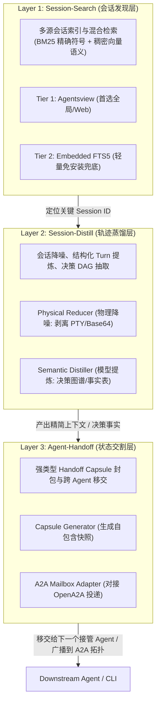

# RFC-002: Agent-Handoff 架构演进与多层会话检索规范
## —— 从单向移交到“会话发现、轨迹蒸馏、状态交割”三层一体化基础设施

- **文档版本**：v1.0.0
- **目标仓库**：`/home/shenzhou/Codes/Agents/agent-handoff` (原 `handoff`)
- **下游执行者**：`agent-handoff` 专项研发 Agent
- **参考工件**：
  - 嵌入式引擎深度调研报告：`embedded-search-engine-research.md`
  - 关联框架：`Arborist-Orca`、`OpenA2A`、`Agentsview`

---

## 目录
1. [背景与架构定位](#1-背景与架构定位)
2. [三层会话能力拓扑模型](#2-三层会话能力拓扑模型)
3. [Session-Search 双轨混合检索架构设计](#3-session-search-双轨混合检索架构设计)
   - 3.1 总体分流逻辑
   - 3.2 Tier 1: Agentsview 适配器
   - 3.3 Tier 2: 零 Daemon 嵌入式内核 (SQLite FTS5 + trigram + sqlite-vec)
   - 3.4 统一 Search Envelope 协议与输出标准
4. [工程改造与包迁移方案 (handoff -> agent-handoff)](#4-工程改造与包迁移方案)
   - 4.1 目录组织与向后兼容性保证
   - 4.2 pyproject.toml 与 CLI 入口映射
   - 4.3 文档与 Skill 资产同步
5. [研发任务拆解与实施路线图 (Phase 1 ~ Phase 3)](#5-研发任务拆解与实施路线图)
6. [验收标准与测试套件建议](#6-验收标准与测试套件建议)

---

## 1. 背景与架构定位

随着 Multi-Agent 协作体系（Arborist-Orca 与 OpenA2A）的纵深发展，原本专注于单次会话状态交接的 `handoff` 库已经逐渐演进为 Agent 间不可或缺的**上下文生命周期治理基础设施**。

在长程工程任务中，Agent 常常面临三大痛点：
1. **历史盲目**：不清楚历史上有哪些 Agent 参与过该工程、讨论过哪些方案、何时推翻过哪些决策（**需要 Discovery**）；
2. **上下文膨胀**：数百轮交互日志动辄数十兆，工具执行流水与 base64 噪音充斥，无法直接灌入上下文（**需要 Distillation**）；
3. **协作断层**：前序 Agent 结束或崩溃后，无法以自包含、强类型的方式把未完成决策与现场移交给后序 Agent（**需要 Handoff**）。

因此，项目正式更名为 **`agent-handoff`**，明确其作为**“会话发现、轨迹蒸馏、状态交割三位一体基础设施”**的核心定位。

---

## 2. 三层会话能力拓扑模型



- **Layer 1: `session-search`**：负责“大海捞针”。在海量历史 Transcripts 中快速根据关键词、错误堆栈、代码符号或语义意图，召回候选 Session ID 与对应轮次切片。
- **Layer 2: `session-distill`**：负责“沙里淘金”。把选定的单次或多次数十兆长会话进行物理裁剪与语义浓缩，输出核心决策流（DecisionDAG）与代码变更事实。
- **Layer 3: `handoff` (核心交割)**：负责“安全递棒”。把提炼后的上下文、未决待办、验证清单组装为标准 Handoff Capsule，对接 OpenA2A 进行跨 Agent 投递。

---

## 3. Session-Search 双轨混合检索架构设计

### 3.1 总体分流逻辑

检索引擎必须满足**“绝不常驻重型 Daemon、冷启动 < 10ms、离线沙箱 100% 自愈”**的硬指标。

```
                     ┌────────────────────────────────────┐
                     │ agent-handoff search [QUERY]       │
                     └─────────────────┬──────────────────┘
                                       │
                    [系统是否具备可用的 agentsview CLI/MCP?]
                                  ╱          ╲
                         是 (首选)            否 (无缝降级)
                            ▼                       ▼
              ┌──────────────────┐    ┌───────────────────────────┐
              │ Tier 1 适配器    │    │ Tier 2 嵌入式引擎         │
              │ (AgentsviewCLI   │    │ (基于 SQLite FTS5 trigram)│
              │   / MCP 桥接)    │    │  • 纯 Python 标准库 0 依赖 │
              └────────┬─────────┘    │  • 可插拔 160KB sqlite-vec│
                       │              └─────────────┬─────────────┘
                       │                            │
                       └──────────────┬─────────────┘
                                      ▼
                      [统一输出标准化 Search Envelope]
```

### 3.2 Tier 1: Agentsview 适配器 (`agentsview_adapter.py`)
- **检测机制**：探测 PATH 是否存在 `agentsview`，或是否存在活动后台服务（`http://127.0.0.1:59090`）。
- **交互方式**：
  - 优先调用 `agentsview session search "<QUERY>" --project "<PROJECT>" --json`
  - 或通过 stdio 启动 `agentsview mcp` 协议调用 `session_search` 工具。
- **优势**：直接复用本地全局的已建索引与预计算好的向量 Embedding，支持跨项目的多 Agent 全景看板。

### 3.3 Tier 2: 零 Daemon 嵌入式内核 (`embedded_engine.py`)
在没有安装或无法启动 `agentsview` 的极简环境下，自动启用基于 SQLite 的内置引擎：
1. **L0 词法底座 (必须)**：
   - 依赖：**仅依赖 Python 标准库 `sqlite3`**，外部依赖为 0。
   - 倒排索引：采用 SQLite FTS5 的 `trigram` 分词器：
     ```sql
     CREATE VIRTUAL TABLE IF NOT EXISTS session_turns_fts USING fts5(
         session_id UNINDEXED,
         turn_id UNINDEXED,
         role UNINDEXED,
         content,
         tokenize = 'trigram'
     );
     ```
   - **核心优势**：无需引入 `jieba` 分词词典，对中文字符串、代码下划线/驼峰符号（如 `BaseSessionAdapter`）、UUID、Git SHA 原生支持任意子串快速召回，冷启动 < 3ms。
2. **L1 向量增强 (可选插拔)**：
   - 依赖：可选安装纯 C 构建的 `sqlite-vec`（单 wheel 仅 ~160KB，无 C++ / Faiss 沉重包袱）。
   - 混合排序：在同一 `.db` 文件中使用纯 SQL 的 CTE 与 RRF (Reciprocal Rank Fusion) 算法：
     ```sql
     WITH fts_matches AS (
         SELECT rowid, rank AS fts_score,
                ROW_NUMBER() OVER (ORDER BY rank) AS fts_rank
         FROM session_turns_fts
         WHERE session_turns_fts MATCH :query
         LIMIT 50
     ),
     vec_matches AS (
         SELECT rowid, distance AS vec_dist,
                ROW_NUMBER() OVER (ORDER BY distance ASC) AS vec_rank
         FROM session_turns_vec
         WHERE embedding MATCH :query_vec AND k = 50
     )
     SELECT 
         COALESCE(f.rowid, v.rowid) AS rowid,
         (COALESCE(1.0 / (60 + f.fts_rank), 0.0) + 
          COALESCE(1.0 / (60 + v.vec_rank), 0.0)) AS rrf_score
     FROM fts_matches f
     FULL OUTER JOIN vec_matches v ON f.rowid = v.rowid
     ORDER BY rrf_score DESC
     LIMIT :limit;
     ```

### 3.4 统一 Search Envelope 协议与输出标准
无论底层由 Tier 1 还是 Tier 2 驱动，CLI 与 API 统一返回如下确定性 JSON 数据结构：
```json
{
  "protocol": "agent-handoff:search:v1",
  "engine": "agentsview|embedded_fts5|embedded_hybrid",
  "query": "异构 A2A 架构设计",
  "project": "Arborist-Orca",
  "total_hits": 4,
  "results": [
    {
      "session_id": "antigravity-cli:c62c9bb5-4a11-409b-ae7f-8557a2c49980",
      "harness": "antigravity-cli",
      "score": 0.0328,
      "snippet": "探讨了 <b>异构 A2A 架构</b> 愿景，提出去中心化 Mailbox 规范...",
      "matched_turns": [45, 48],
      "turn_count": 160,
      "created_at": "2026-09-24T18:30:00Z"
    }
  ]
}
```

---

## 4. 工程改造与包迁移方案 (`handoff` -> `agent-handoff`)

### 4.1 目录组织与向后兼容性保证
重命名工作树为 `Codes/Agents/agent-handoff`，并保持软链接 `Codes/Tool_Dev/agent-handoff -> /home/shenzhou/Codes/Agents/agent-handoff` 与 `Codes/Tool_Dev/handoff -> /home/shenzhou/Codes/Agents/agent-handoff`。

在源码层面采用**三向别名包结构**，保证历史调用 100% 不破坏：
```
src/
├── agent_handoff/              <-- 主包源码命名空间
│   ├── __init__.py
│   ├── cli.py                  <-- 统一 CLI 分发入口
│   ├── core/                   <-- Handoff 状态生成与转移内核
│   ├── distill/                <-- Session-Distill 轨迹浓缩内核
│   ├── search/                 <-- Session-Search 双轨检索内核
│   │   ├── __init__.py
│   │   ├── base.py             <-- BaseSearchEngine 契约抽象
│   │   ├── agentsview.py       <-- Tier 1 适配器
│   │   └── embedded.py         <-- Tier 2 SQLite FTS5 / sqlite-vec 引擎
│   └── models/                 <-- 强类型 Envelope 与 Capsule 数据类
├── handoff/                    <-- 兼容层 (导出 agent_handoff 内容)
│   └── __init__.py             <-- from agent_handoff import *
└── session_distill/            <-- 兼容层 (符号链接或纯导出包)
    └── __init__.py
```

### 4.2 `pyproject.toml` 统一配置
```toml
[project]
name = "agent-handoff"
version = "0.2.0"
description = "Universal Multi-Agent Handoff Protocol, Trajectory Distillation, and Session Search Engine."
readme = "README.md"
requires-python = ">=3.10"
dependencies = []

[project.optional-dependencies]
vector = ["sqlite-vec>=0.1.3"]

[project.scripts]
agent-handoff = "agent_handoff.cli:main"
handoff = "agent_handoff.cli:main"
session-distill = "agent_handoff.cli:main"
session-search = "agent_handoff.cli:search_main"
```

---

## 5. 研发任务拆解与实施路线图

### Phase 1: 命名空间重构与向后兼容性测试 (P0)
- 将 `src/handoff` 重命名为 `src/agent_handoff`。
- 构建兼容垫片 `src/handoff/__init__.py` 与 `src/session_distill/__init__.py`。
- 更新 `pyproject.toml` 包名与脚本指令，确保原测试集（`tests/`）全量绿灯通过。

### Phase 2: Session-Search 核心引擎研发 (P1)
- 实现 `src/agent_handoff/search/base.py` 抽象契约。
- 实现 `src/agent_handoff/search/embedded.py`：
  - JSONL 流式物理降噪；
  - SQLite FTS5 `trigram` 倒排表创建与增量写入；
  - `sqlite-vec` 动态扩展探测与可选加载；
  - 纯 SQL RRF 混合打分算法与 `snippet()` 上下文抽取。
- 实现 `src/agent_handoff/search/agentsview.py`：
  - 自动探测宿主 `agentsview` CLI 与活跃服务；
  - 命令解析与结果归一化映射为 `SearchEnvelope`。
- 实现统一路由逻辑：存在 `agentsview` 时走 Tier 1，不存在时静默降级为 Tier 2。

### Phase 3: CLI 联动与上游集成 (P2)
- 为 `agent-handoff` 增加 `search` 子命令（以及独立的 `session-search` 二进制入口）。
- 打通与 `distill` 的管道调用：
  ```bash
  agent-handoff search "A2A Protocol" --json | agent-handoff distill --pipe
  ```
- 更新 `SKILL.md`，同步至 Arborist-Orca / Codex / Claude Code skill 目录。

---

## 6. 验收标准与测试套件建议

1. **零依赖环境验证**：在未安装 `agentsview`、未安装 `sqlite-vec` 的全新 Python 虚拟环境中，`session-search` 必须能依靠标准库直接完成 JSONL 解析与精确 FTS 检索，退出无常驻进程。
2. **冷启动测试**：`agent-handoff search --help` 与嵌入式单次点查在 10,000 条记录内耗时 < 50ms。
3. **兼容性验证**：原有的 `import handoff`、`import session_distill` 导入以及 `handoff --version` 必须 100% 正常运行，API 无破坏。
4. **集成测试**：在 `Arborist-Orca` 环境中运行 `test_session_handoff_reader.py`，确认现有调用与子模块协同无缝。
